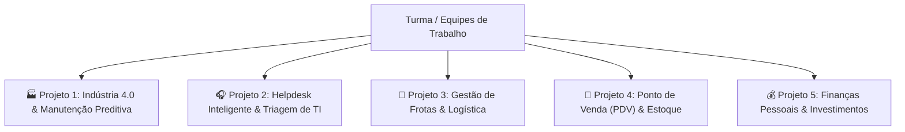

# 🎓 Situação de Aprendizagem: Projetos Práticos Integradores

> **Curso:** Lógica de Programação e Introdução ao Python (60 horas)  
> **Instrutor:** Dione Nascimento  
> **Metodologia:** Aprendizagem Baseada em Projetos (PBL) em Equipes  

---

## 📌 1. Visão Geral e Dinâmica em Equipes

Para consolidar as competências de lógica formal (Manzano) e desenvolvimento prático em Python (Nilo Coutinho), a turma será dividida em **equipes de trabalho**. Cada equipe selecionará **1 dos 5 projetos temáticos** abaixo para desenvolver de forma incremental ao longo do curso.

Ao final do treinamento, cada equipe entregará:
1. **O Diagrama de Blocos formal (ISO 5807)** modelando o fluxo principal.
2. **O Código-Fonte em Python (`.py`)** completo, modular e comentado.
3. **A Base de Dados Relacional (`.db`)** no SQLite persistindo os registros.
4. **Uma Apresentação de 10 minutos** demonstrando o software funcionando no terminal.

---

## 🚀 2. Cardápio dos 5 Projetos Práticos

---

### 🏭 PROJETO 1: Sistema de Monitoramento e Manutenção Preditiva (Indústria 4.0)
* **Contexto:** Uma fábrica siderúrgica possui equipamentos críticos (motores, redutores e fornos) operando em regime contínuo. Para evitar paradas de emergência que causam prejuízos milionários, a gerência de manutenção necessita de um sistema de telemetria e diagnóstico precoce de falhas.
* **Escopo Funcional:**
  * **Entrada de Dados:** Leitura de sensores (temperatura em °C, nível de vibração em mm/s e pressão em bar).
  * **Regras de Decisão:** 
    * Normal: Temperatura < 70°C e Vibração < 4.5 mm/s.
    * Alerta: Temperatura entre 70°C e 90°C ou Vibração entre 4.5 e 7.0 mm/s.
    * Parada Crítica: Temperatura > 90°C ou Vibração > 7.0 mm/s (acionar alarme imediato).
  * **Operação Contínua:** Loop monitorando medições turno a turno.
  * **Persistência:** Registro de ocorrências críticas em arquivo `historico_falhas.txt` e banco SQLite `manutencao.db`.

---

### 🎧 PROJETO 2: Sistema Inteligente de Triagem e Chamados (Helpdesk / TI)
* **Contexto:** O departamento de tecnologia de uma empresa corporativa recebe um volume massivo de solicitações de suporte. Atendimentos manuais provocam atrasos e desrespeito aos prazos contratuais de SLA (*Service Level Agreement*).
* **Escopo Funcional:**
  * **Entrada de Dados:** Cadastro de chamado (matrícula do colaborador, setor e descrição do problema).
  * **Triagem Inteligente:** Varredura na descrição por palavras-chave críticas (*"parou"*, *"urgente"*, *"sem sistema"*, *"servidor fora"*). Se identificadas, a prioridade é automaticamente elevada para **Nível 1 (Crítico)** com SLA de 2 horas.
  * **Fila de Atendimento:** Gestão de fila usando lista FIFO (`append` para chegada e `pop(0)` para atendimento).
  * **Persistência:** Exportação de relatório de chamados em CSV e tabela `tickets` em banco SQLite `helpdesk.db`.

---

### 🚛 PROJETO 3: Sistema de Gestão de Frotas e Logística Operacional
* **Contexto:** Uma distribuidora logística opera com dezenas de vans e caminhões. O gestor de transporte precisa rastrear o consumo de combustível de cada rota, calcular o custo por quilômetro rodado e bloquear veículos com manutenção preventiva vencida.
* **Escopo Funcional:**
  * **Entrada de Dados:** Placa do veículo, quilometragem inicial e final da viagem, quantidade de litros abastecidos e valor do combustível por litro.
  * **Cálculos e Validações:**
    * Consumo médio: $\text{km/l} = \frac{\Delta \text{km}}{\text{litros}}$.
    * Custo total da viagem e custo por km rodado.
    * Alerta de velocidade máxima e validação sintática de placas no padrão Mercosul (ex: `BRA2E19`).
  * **Persistência:** Armazenamento do cadastro da frota e do histórico de fretes no SQLite `frota.db`.

---

### 🏪 PROJETO 4: Ponto de Venda (PDV) e Controle de Estoque Comercial
* **Contexto:** Um minimercado ou loja de ferramentas deseja substituir as anotações manuais em papel por um terminal de vendas automatizado que dê baixa automática no estoque e calcule descontos comerciais.
* **Escopo Funcional:**
  * **Catálogo de Produtos:** Dicionário com código de barras, descrição, preço unitário e estoque atual.
  * **Carrinho de Compras Interativo:** Laço contínuo permitindo ao operador bipar/digitar produtos até o fechamento da compra.
  * **Políticas de Desconto:**
    * Pagamento à vista (PIX ou dinheiro): 5% de desconto.
    * Compras acima de R$ 150,00: 3% de desconto adicional.
    * Parcelamento no cartão em até 3x sem juros.
  * **Persistência:** Emissão de cupom fiscal em arquivo texto (`cupom_fiscal.txt`) e atualização permanente do estoque no SQLite `pdv.db`.

---

### 💰 PROJETO 5: Assistente e Simulador de Finanças Pessoais & Investimentos
* **Contexto:** Criar um aplicativo intuitivo de console que atue como educador financeiro para jovens profissionais, ajudando-os a diagnosticar gastos excessivos e planejar metas de aposentadoria ou reserva de emergência.
* **Escopo Funcional:**
  * **Orçamento Mensal:** Registro de receitas líquidas e despesas categorizadas (Moradia, Alimentação, Transporte, Lazer).
  * **Diagnóstico da Regra 50/30/20:** Análise se os gastos essenciais ultrapassam 50% da renda.
  * **Simulador de Juros Compostos:** Cálculo do patrimônio acumulado mês a mês com depósitos regulares:
    $$M = P \cdot (1 + i)^n$$
  * **Persistência:** Exportação do extrato anual consolidado e gravação de histórico orçamentário no SQLite `financas.db`.

---

## 📅 3. Cronograma de Entregas Incrementais (Sprints)

O projeto é construído em 4 etapas sincronizadas com as aulas:

| Etapa / Sprint | Conteúdo Vinculado | O que a equipe deve entregar? |
| :---: | :--- | :--- |
| **Sprint 1 (Semana 2)** | Manzano (Cap. 1 a 3) | **Documento de Requisitos & Diagrama de Blocos (ISO 5807):** Desenho formal do fluxo principal do sistema e o Teste de Mesa manual. |
| **Sprint 2 (Semana 4)** | Nilo Coutinho (Cap. 1 a 4) | **Script com Entradas & Decisões:** Código Python implementando `input()`, casting numérico, e a árvore de validação `if / elif / else`. |
| **Sprint 3 (Semana 6)** | Nilo Coutinho (Cap. 5 a 7) | **Menu Interativo & Coleções:** Menu principal com `while True`, controle de listas/dicionários e manipulação de textos. |
| **Sprint 4 (Semana 8)** | Nilo Coutinho (Cap. 8 a 11) | **Projeto Final Integrado:** Código modularizado com funções (`def`), persistência de arquivos (`with open`) e banco SQLite funcional. |

---

## 🏆 4. Critérios de Avaliação (Rubrica de Pontuação)

* **1. Correção Lógica e Algorítmica (25%):** O programa atende a todas as regras de negócio sem travamentos ou falhas lógicas?
* **2. Tratamento de Exceções e Robustez (20%):** O sistema lida bem com entradas inválidas do usuário (ex: digitar texto onde se espera número)?
* **3. Estrutura e Boas Práticas (20%):** Nomes semânticos de variáveis (PEP 8), funções bem organizadas e ausência de código duplicado?
* **4. Persistência de Dados (15%):** Gravação e consulta corretas no SQLite e arquivos de texto?
* **5. Apresentação e Demonstração da Equipe (20%):** Clareza técnica, domínio do código e resposta às perguntas do instrutor durante o pitch final.
