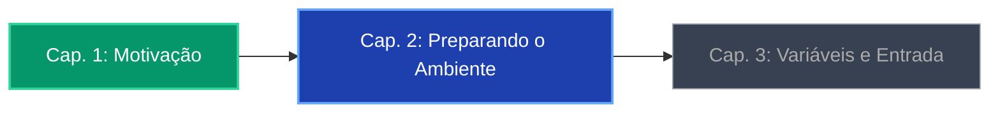

# Capítulo 01
# Motivação

Introdução à Programação com Python — *Nilo Coutinho*

<div class="pt-8">
  <span class="px-4 py-2 bg-emerald-600 text-white rounded-lg text-sm font-mono tracking-wide shadow-lg">
    🚀 Primeiros Passos no Mundo do Código
  </span>
</div>

<div class="abs-bottom-margin text-xs text-gray-400">
  Navegue com as setas do teclado ou barra de espaço
</div>

---
layout: default
---

# As 4 Perguntas Iniciais

Antes de escrever qualquer linha de código, responda com sinceridade:

<v-clicks>

1. 🎯 **Você realmente quer aprender a programar?**  
   *A curiosidade e a vontade genuína são o combustível do aprendizado.*

2. 🧘 **Como está seu nível de paciência?**  
   *Computadores fazem exatamente o que mandamos — inclusive nossos erros.*

3. ⏰ **Quanto tempo você pretende estudar?**  
   *Consistência diária (ex: 30 a 60 min) supera maratonas esporádicas.*

4. 🏁 **Qual é o seu objetivo?**  
   *Automatizar rotinas, mudar de carreira, criar jogos ou analisar dados?*

</v-clicks>

---
layout: two-cols
---

# O que é um Programa?

Uma sequência lógica e ordenada de instruções que um computador executa para resolver um problema.

<v-click>

### Lógica de Programação
É a habilidade de decompor um problema grande em passos simples e executáveis.

</v-click>

::right::

<div class="ml-6 p-4 bg-gray-800/60 rounded-xl border border-gray-700 shadow-md">

### 🍰 Analogia: A Receita de Bolo

- **Entrada (Ingredientes):** Farinha, ovos, açúcar
- **Processamento (Instruções):**
  1. Misture os ingredientes
  2. Bata por 5 minutos
  3. Asse a 180°C por 40 minutos
- **Saída:** O bolo pronto!

<v-click>

> Se você pular um passo ou trocar a ordem, o resultado não será o esperado.

</v-click>

</div>

---
layout: default
---

# A Mentalidade de Quem Aprende a Programar

<div class="grid grid-cols-3 gap-4 pt-4">

<v-click>
<div class="p-4 bg-blue-900/30 border border-blue-700/50 rounded-lg">
  <div class="text-2xl mb-2">🐛</div>
  <h3 class="font-bold text-blue-400 mb-1">Erros são normais</h3>
  <p class="text-xs text-gray-300">Mensagens de erro não são broncas; são pistas valiosas indicando onde ajustar o raciocínio.</p>
</div>
</v-click>

<v-click>
<div class="p-4 bg-emerald-900/30 border border-emerald-700/50 rounded-lg">
  <div class="text-2xl mb-2">🔍</div>
  <h3 class="font-bold text-emerald-400 mb-1">Depurar (Debug)</h3>
  <p class="text-xs text-gray-300">Investigar o código linha por linha, entender o fluxo e encontrar o ponto de falha.</p>
</div>
</v-click>

<v-click>
<div class="p-4 bg-amber-900/30 border border-amber-700/50 rounded-lg">
  <div class="text-2xl mb-2">🛠️</div>
  <h3 class="font-bold text-amber-400 mb-1">Prática contínua</h3>
  <p class="text-xs text-gray-300">Não basta ler o livro: você precisa digitar, testar, alterar e quebrar o código de propósito.</p>
</div>
</v-click>

</div>

---

# O Primeiro Código: `Olá mundo`

O tradicional ritual de iniciação na programação:

````python {all|1-4|6|all}
# As aspas simples '' ou duplas "" delimitam um texto (string)
# print é uma função embutida que imprime informações na saída padrão
# Os parênteses () recebem os argumentos que a função deve processar

print("Olá mundo")
````

<v-clicks>

### Anatomia da Instrução:
- `print` $\rightarrow$ Nome da ação/função que pede ao computador para exibir algo.
- `(` `)` $\rightarrow$ Envolvem os dados que serão passados para a função.
- `"Olá mundo"` $\rightarrow$ O dado em si: uma sequência de caracteres (texto).

</v-clicks>

---
layout: center
class: text-center
---

# Resumo & Próximos Passos



<div class="mt-8 text-lg font-semibold text-emerald-400">
  Na próxima aula: Instalando o Python, IDLE e primeiros testes no interpretador!
</div>

---
layout: end
class: text-center
---

# Bons estudos e mãos na massa! 🐍

Dúvidas ou comentários?
